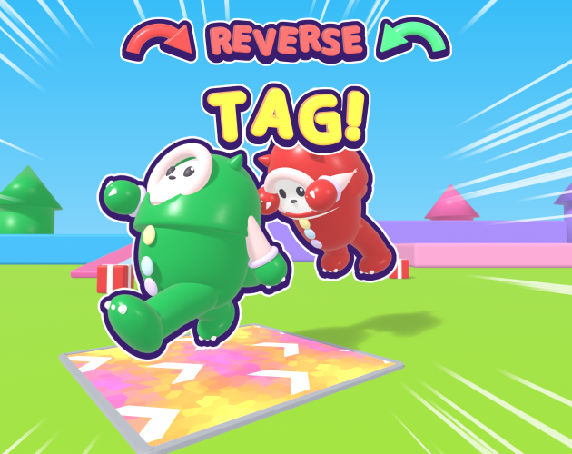
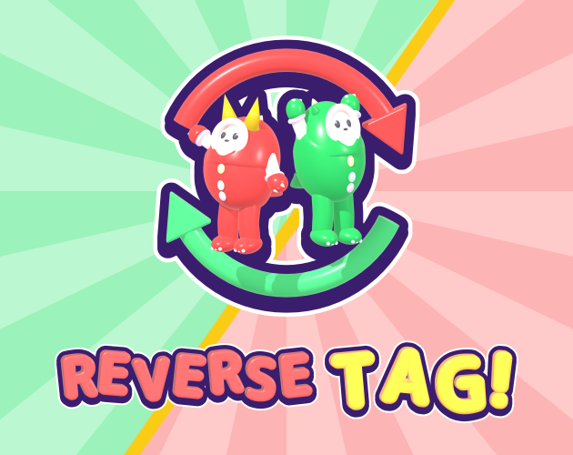
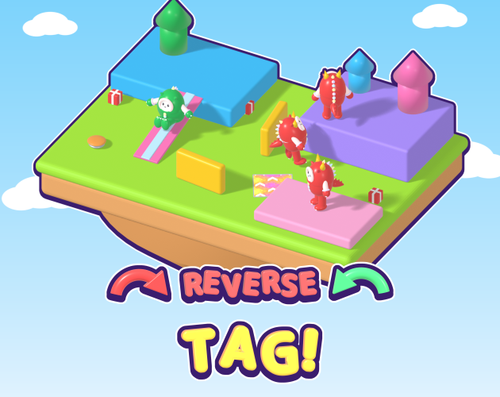
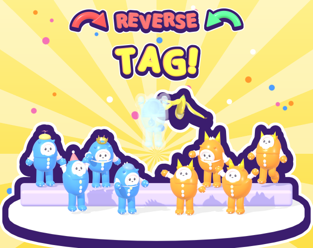

# カバー画像の別案 4つ（KAN-87、2026-11-10）

いまのカバー `cover_v1_title.png`（壁の陰に隠れる緑と、反対を向いて探す赤）とは**別の切り口**で、
4つの案を作った。採用する案は画像の担当（ハマちゃん）が決める。v1 のままでもよい。

- どれも 630x500 の PNG（itch.io のカバー）で、タイトル「REVERSE TAG!」とゲームのキャラ（きょうりゅう）が入っている
- タイトルは英語だけ（日本語の題は入れない。mpahap76 の指定）
- 並べて見るときは `cover_v2_sheet.png`。上の4枚が原寸、下の4枚が itch.io の最小表示（315x250）

| 案 | ファイル | 一言で |
|---|---|---|
| A つかまる寸前 | `cover_v2a_close_call.png` | 逃げる緑のすぐ後ろへ、角の赤が飛びつく一瞬 |
| B 逆転 | `cover_v2b_reverse.png` | 入れ替わりの矢印の輪の中に、背中合わせの鬼と逃げる人 |
| C 遊び場ジオラマ | `cover_v2c_playground.png` | 空に浮かぶ島のマップで、滑り台の緑と探し回る赤 |
| D 4対4パーティー | `cover_v2d_team_up.png` | 青と橙の2チームが並ぶ、Reverse Tag モードの集合写真 |

## 作り方

画像生成ツールは使っていない。v1 と同じく、Blender のスクリプトでゲーム内のモデルからシーンを組んで描いた。

```text
blender -b -P tools/blender/build_cover_concepts.py -- docs/concept/store/cover_image --sheet
```

- キャラ・帽子・ダッシュパネル・バネ・プレゼント箱・バナナは、`tools/blender/` にあるゲームの `.blend` をそのまま読み込んだ。
  ストアの絵とゲームの見た目が食い違わない
- タイトルの文字・色・ふち取りは、タイトル画面のロゴ（`tools/blender/build_ui_art.py`）と同じ作り方にした。
  4案とも同じ書体と色なので、どの案でもゲームのロゴと同じに見える
- 背景（空・放射線・紙ふぶき・雲）は numpy で描いた 2D。SPEC の色をそのまま出すため

## 参考にした itch.io の人気作

itch.io の「Top rated」の multiplayer と party-game の一覧から、キャラが主役の明るい作品を中心に12本のカバーを見た
（2026-11-10 時点）。画像はリポジトリに入れていない。見たのは**構図・文字の置き方・キャラの大きさ・色の使い方**だけで、
キャラ・ロゴ・画面は真似していない。

| 作品 | ページ | 見て取ったこと | 活かした案 |
|---|---|---|---|
| Among Us | <https://innersloth.itch.io/among-us> | 主役1人を真ん中に大きく、仲間を周りに散らす。タイトルは上 | D |
| Pikuniku | <https://devolverdigital.itch.io/pikuniku> | 丘の上にキャラを横一列に並べた集合写真。タイトルは下で大きく、背景は淡い | C（タイトルを下に）・D（並べる） |
| WEBFISHING | <https://lamedeveloper.itch.io/webfishing> | ゲーム画面そのままの3Dで、キャラに大きく寄る。実物の見た目が伝わる | A |
| PolyTrack | <https://kodub.itch.io/polytrack> | ゲーム内の3Dで、低い位置から動きのある瞬間を撮る。タイトルは上に大きく | A |
| Narrow One | <https://pelicanparty.itch.io/narrow-one> | 画面からはみ出すほど寄った斜めの構図と、放射状の速度線 | A（速度線） |
| Gladihoppers | <https://dreamonstudios.itch.io/gladihoppers> | 2人がぶつかり合う瞬間。何をするゲームかが一目で分かる | A |
| Pikwip | <https://cookiecrayon.itch.io/pikwip> | 大きなタイトルを真ん中に、2人のキャラが向かい合う。余白が多くて読みやすい | B |
| Wrestle Jump 2 | <https://ottoojala.itch.io/wrestle-jump-2> | 赤と青の2人だけを、無地に近い背景に置く。色の対立がそのまま主題 | B |
| Party Project | <https://char64.itch.io/partyproject> | 斜めの帯と、真ん中に大きなロゴの図案的な構図 | B（斜めの塗り分け） |
| Soccer Physics | <https://ottoojala.itch.io/soccer-physics> | 平らな背景にキャラ数人。タイトルは上 | B・D |
| Kaaarot | <https://lambdahumans.itch.io/kaaarot> | 傾いた構図で動きを出し、タイトルは下 | C |
| Sneaky Stealy | <https://ironchestgames.itch.io/sneaky-stealy> | 隠れて盗む、を明暗で見せる（v1 の「隠れる」に近いので、今回は避けた） | — |

共通していたこと:

1. **タイトルは画面の上か下に、横幅の6〜8割の大きさで置く**。縮小されても読めるのはこの大きさまで
2. **キャラは大きく、数は少なめ**。集合写真にする場合も、1人ずつの顔が分かる大きさにしている
3. **背景は単純にする**（淡い単色・ぼかし・放射線）。キャラとタイトルが背景に沈まない
4. **2色の対立**（赤と青など）や、斜めの線・速度線で、止まった絵でも動きを出す
5. ゲーム画面そのままの3Dで描いた作品も多い。遊ぶ前に見た目が分かる

## 案 A つかまる寸前（Close Call）



- **コンセプト**: 鬼ごっこでいちばん盛り上がる「触れられたら負け」の一瞬。走って逃げる緑のすぐ後ろへ、角の赤がダイブで飛びつく
- **伝えたいこと**: アクションのある鬼ごっこだということ。キャラのかわいさと、追いかけっこのドタバタ感
- **構図**: 低いカメラ・広角で2人に大きく寄る。背景の段丘・塔・プレゼント箱はぼかし、画面の外周に白い速度線。
  緑はダッシュパネルを踏んで加速したところ。タイトルは上（ロゴと同じ2段に、入れ替わりの矢印）
- **配色**: 空の水色と芝の黄緑の上に、緑と赤の2人。ダッシュパネルの黄色・ピンクがアクセント
- **参考にしたこと**: PolyTrack・WEBFISHING（ゲーム内の3Dで寄る）、Gladihoppers（2人がぶつかる瞬間）、Narrow One（速度線）
- **縮小したとき**: 2人が大きいので、315x250 でも緑と赤のキャラとタイトルが分かる
- **気になる点**: 走りのポーズは前かがみなので、緑の顔は少し下を向いている。鬼の赤は陰の面なので、SPEC の赤より暗い（#c55454）

## 案 B 逆転（Reverse!）



- **コンセプト**: タイトルの「Reverse（逆転）」を図案で見せる。鬼と逃げる人が入れ替わる
- **伝えたいこと**: 追う側と逃げる側が入れ替わるゲームだということ。アイコン（入れ替わりの矢印）と同じ記号なので、ストアでアイコンとカバーが同じゲームだと分かる
- **構図**: 背景を斜めに緑の地と赤の地へ分け、**赤い鬼を緑の地に、緑の逃げる人を赤の地に**立たせる（立場の入れ替わりを色でも示す）。
  2人は背中合わせで、その周りを赤と緑の矢印が回る。タイトルは下に1行で大きく
- **配色**: 淡い緑と淡いピンクの地に、同じ色の放射線。境目に黄色の線。キャラとタイトルには、ロゴと同じ紫と白のふち
- **参考にしたこと**: Wrestle Jump 2（赤と青の2人だけで対立を見せる）、Pikwip（2人＋大きなタイトル＋余白）、Party Project（斜めの塗り分け）
- **縮小したとき**: 4案でいちばん強い。形が単純なので、315x250 でもアイコンのように読める
- **気になる点**: マップや遊んでいる場面が出ないので、どんな遊びかは伝わりにくい。スクリーンショットで補う前提

## 案 C 遊び場ジオラマ（Playground）



- **コンセプト**: カラフルなマップそのものを主役にする。空に浮かぶ島のおもちゃ箱のように見せる
- **伝えたいこと**: 広いマップを走り回り、隠れ場所を探す楽しさ。滑り台・ダッシュパネル・バネ・壁などのギミックがあること
- **構図**: 段丘のマップを斜め上から見下ろす（平行投影でミニチュアらしく）。島全体を紫と白のふちで囲んだ。
  緑は青い段から滑り台を滑ってきて、赤3人は壁の陰・紫の段の上・ピンクの段の上で、それぞれ別の方を探している。タイトルは島の下の空に
- **配色**: ゾーンの4色（水色・紫・ピンク・黄緑）が全部入る。SPEC の「背景はゾーンのテーマ色」にいちばん素直
- **参考にしたこと**: Pikuniku・Kaaarot（タイトルを下に置く）、v1 で効いていた「鬼から見えていない」関係（鬼は全員よそを向いている）
- **縮小したとき**: キャラが小さいので、315x250 では緑のキャラが見つけにくい。島とタイトルは分かる
- **気になる点**: キャラが小さく、人物よりも場所の絵になる。ゲームのマップは地上にある160m四方の段丘で、空に浮いた島ではない（絵としての誇張）。キャラもマップに対して大きめに描いている

## 案 D 4対4パーティー（Team Up!）



- **コンセプト**: もう1つのモード「Reverse Tag（4対4・攻守入れ替え）」の、みんなでわいわい遊ぶ感じ
- **伝えたいこと**: 友だちと大人数で遊べること。帽子の着せ替えがあること。捕まっても幽霊になって復活をねらえること
- **構図**: 2段のステージに、左は青チーム（いまは逃げる番。帽子をかぶっている）、右は橙チーム（いまは鬼の番なので角）が4人ずつ並ぶ。
  上には捕まって幽霊になった青の1人が、バナナを掲げて浮いている。タイトルは上
- **配色**: チームの色はゲームの `TEAM_COLORS`（青 #4d9eff・橙 #ff992e）、幽霊はゲームの `GHOST_COLOR`。背景は黄色の放射線と紙ふぶき
- **参考にしたこと**: Pikuniku（横一列の集合写真）、Among Us（大人数で、真ん中の上に目を引く1人）
- **縮小したとき**: 315x250 では1人ずつが小さく、帽子は見分けにくい。2色のチームとタイトルは分かる
- **気になる点**: 赤と緑の役割の色（アイコン・v1・SPEC）が出てこない。幽霊は半透明なので、明るい背景では薄い

## 選ぶときの目安

- ストアの一覧で**目立つこと**を優先するなら B
- **遊んでいる場面**を見せたいなら A
- **マップとギミック**を見せたいなら C（ただし一覧での小ささに注意）
- **大人数で遊べること**を見せたいなら D
- どの案も、採用したら `REVIEW.md` の判定を見てから KAN-65 でアップロードする
